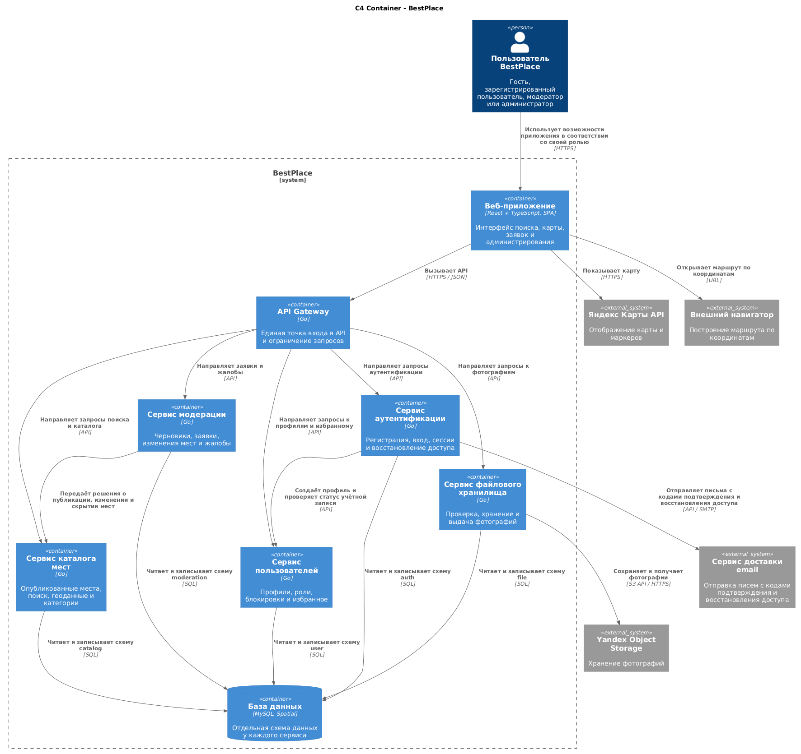

```plantUML
@startuml
!include <C4/C4_Container>

title C4 Container - BestPlace

Person(user, "Пользователь BestPlace", "Гость, зарегистрированный пользователь, модератор или администратор")

System_Boundary(bestplace, "BestPlace") {
    Container(web, "Веб-приложение", "React + TypeScript, SPA", "Интерфейс поиска, карты, заявок и администрирования")
    Container(gateway, "API Gateway", "Go", "Единая точка входа в API и ограничение запросов")

    Container(auth, "Сервис аутентификации", "Go", "Регистрация, вход, сессии и восстановление доступа")
    Container(users, "Сервис пользователей", "Go", "Профили, роли, блокировки и избранное")
    Container(catalog, "Сервис каталога мест", "Go", "Опубликованные места, поиск, геоданные и категории")
    Container(moderation, "Сервис модерации", "Go", "Черновики, заявки, изменения мест и жалобы")
    Container(files, "Сервис файлового хранилища", "Go", "Проверка, хранение и выдача фотографий")

    ContainerDb(db, "База данных", "MySQL, Spatial", "Отдельная схема данных у каждого сервиса")
}

System_Ext(maps, "Яндекс Карты API", "Отображение карты и маркеров")
System_Ext(nav, "Внешний навигатор", "Построение маршрута по координатам")
System_Ext(storage, "Yandex Object Storage", "Хранение фотографий")
System_Ext(email, "Сервис доставки email", "Отправка писем с кодами подтверждения и восстановления доступа")

Rel(user, web, "Использует возможности приложения в соответствии со своей ролью", "HTTPS")

Rel(web, gateway, "Вызывает API", "HTTPS / JSON")

Rel(gateway, auth, "Направляет запросы аутентификации", "API")
Rel(gateway, users, "Направляет запросы к профилям и избранному", "API")
Rel(gateway, catalog, "Направляет запросы поиска и каталога", "API")
Rel(gateway, moderation, "Направляет заявки и жалобы", "API")
Rel(gateway, files, "Направляет запросы к фотографиям", "API")

Rel(auth, users, "Создаёт профиль и проверяет статус учётной записи", "API")
Rel(moderation, catalog, "Передаёт решения о публикации, изменении и скрытии мест")

Rel(auth, db, "Читает и записывает схему auth", "SQL")
Rel(users, db, "Читает и записывает схему user", "SQL")
Rel(catalog, db, "Читает и записывает схему catalog", "SQL")
Rel(moderation, db, "Читает и записывает схему moderation", "SQL")
Rel(files, db, "Читает и записывает схему file", "SQL")

Rel(web, maps, "Показывает карту", "HTTPS")
Rel(web, nav, "Открывает маршрут по координатам", "URL")
Rel(files, storage, "Сохраняет и получает фотографии", "S3 API / HTTPS")
Rel(auth, email, "Отправляет письма с кодами подтверждения и восстановления доступа", "API / SMTP")

@enduml
```

[LINK](//www.plantuml.com/plantuml/png/jLRFRnj55BxxhnXoIeIh7iWHeRO15H2b9Wu7JjKcNeBHsexiDMs4aEBTXWGv8ceHKeK4WGFYYEFOPVsZctzXvZ_YVS-pCxkP64ea3fQzi_E-zxtl_NY-qmczTjXj1AKtwisTe5lpnTiRwxStrXzjj9gXLs_wxNTAfR0U1hxOM1VcKDmIz_nEM0cy7RzKglZjJgkvsktuxR9OaMSobJDr8l-Yxw4Sg4YEyMmjLd3h1vcgdehKILdGpO4we5iNCk6p0_e-M5ZBL_ALwik9a9VNmi9yJYSZEIOJdARgGCX4pcGYo7n4RnC2OM1xOsMjLAhkTqA_yUXUgzkiUUtzrMtYjmT-HCzoNHDVbuGGDlRLn_us0dXE_izloKi2XRTKlfHZE99ZnBVfUpkXU5DixU_vrPrsVIyiYshbBeV-WaAAm5Sz9PE9wd5me2YdSa01JQ47qUrhRKufu5HEXHEIerMYJYcq8jzTB_GVU_la-Mxb0t5_yGGYzrjCvqSv0Xxy25Rd20I47Af32Ci_1KpXFfKNK95T7MK1CqieWPo22-Gjal2wuHTmzXldQGZoWZp648BbI4YCX2F_bhwJ7BzVyvM1zuYoRFYL1VaSqziUx9Za43nmdub2cvcbEjA55vFe0qSi57778NfjxI5tEPfd21z1eFJA0a-BN_ASosDg4ZNLD1F2EzTgWkROORFZXLxGsdNuG2O41zmB96ZE2aGvEhzGFcAuXgg5NXgRwoWsMtfbGLXZI9g_ccXlI08w1o8xF1kjcj_smdghwL2rpUbczW-Swmo1PMBhNJz1eZboXm_oRhWpivTQWtFLTpXzNWzy9vFgALbCO8CYGKH27UeKSEBKTt9GJ2gkCW9wqzoszOHwKts8HWqnW8TKHLcVS3rCd7PuTtkrnaFacHmWOc4rLuTm_62_-ib7D37sI5GlM2HKHH0ITPWrQqyTqi7yYhrGCUUCr1bbCVQi1bpqtvZnzzwJSBNXxR5IVn84N4oHk9-o8OJUDmnINR5csEMc5RG06sW5VteIv1mrlQzuT48_TSm04u5ek00kp7JMQqItV6fzCRewfa-CykNg1OCKPcQEeJNcHS-TiDNsTZ7QF_EQDV-9UBZzfKyJkheuPu-_5rExB9KvLB_XrGEdv7d2W8JkTTmoESIOr6z07nR8eU2sriqtXv2NU52HBZxaqhJ0yX67z-w8AstwWLxFUdczK3qxr5HCBYB6HBjXbG4J473bR3Yu619XgAu9HdmPIKpm0XK7E8n8J49sfBw71kzlRLMg6ITcO_UJVAxwHAUFOGLGL9wn4RV5XzM77sUcnYhRB3_BWT5sfavXNzXBgl-l2mVkrehel0zU5tugz1EGSMb-xPoVgtY9DpllNyDVuLy3UN7MmX8dTbWlzsE7i3DdhmV5jFqFEhcj1RKiDeClCcitCfSdvkmpOEQLFX5Sg7POQyUB1a4dOFR7wWYcd8E99WNzhYRV2bJ8o1c0vTWmm8CwjYsH2hjoRLsvIsoXAT96FFigmedTu8NOiIIm9XE4WOXWQOdRJZ6xGCK2fWY8DeWEY2My8HfiYsXQaXlYQMiDwIX-GrGBK0H6MTuqSjXQD3klzBR4WaAQymFBBiCuD-kigTv_M0D8lhKhBhP_Mcl0_NJpIdnskw5BilyekWcoPJ930sHXkgijuLZVmiobKMkecrhCTXtOEnskTJn17F_VAWF31RtgWwqAiRlZDslTHl0t)

